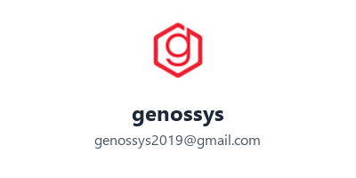

# Rekomendasi Solusi Teknologi: Ekosistem Aplikasi Kopi Seduhan Jodi

<p align="center">
  
</p>

**Dokumen Resmi Rekomendasi Solusi Teknologi & Rencana Implementasi**  
*Versi Ringkas (Executive Summary) — Oktober 2026*  

- **Technology Partner (Pengembang):** **genossys**
- **Email Kontak:** [genossys2019@gmail.com](mailto:genossys2019@gmail.com)
- **Dipersiapkan untuk:** Manajemen & Founder Kopi Seduhan Jodi  
- **Format Dokumen Resmi:** Markdown (`.md`) dan Microsoft Word (`.docx`) — [Rekomendasi_Solusi_Teknologi_Kopi_Seduhan_Jodi.docx](file:///c:/PROJECT/WEBSITE/kopi-jodi/Rekomendasi_Solusi_Teknologi_Kopi_Seduhan_Jodi.docx)

---

## 1. Masalah Operasional & Solusi

### Masalah Utama Coffee Shop:
- **Kebocoran Stok Bahan:** Pengurangan bahan baku (biji kopi, susu, sirup, cup) sering tidak sinkron dengan data kasir.
- **HPP Bias:** Nota pembelian fisik outlet sering terlambat atau tidak diverifikasi Finance pusat.
- **Risiko Fraud Kas Kecil:** Pengeluaran darurat outlet belum memiliki batas approval berjenjang.
- **Laporan Cabang Lambat:** Rekap omzet harian dan perhitungan bagi hasil mitra/investor masih manual.

### Solusi Ekosistem Kopi Seduhan Jodi oleh genossys:
Satu platform terintegrasi (seperti standar Fore / Kopi Kenangan) yang menghubungkan **Kasir POS**, **Layar Barista (KDS)**, **Inventory & Resep Otomatis**, **Approval Pembelian & Kas Kecil**, hingga **Portal Investor**.

---

## 2. Cakupan Modul & Aplikasi

| # | Modul | Platform & Pengguna | Fungsi Utama | Fase |
|---|---|---|---|:---:|
| 1 | **ERP Backoffice & Finance** | Web (Owner, Finance, Admin Pusat, Store Manager) | Pusat kendali stok, pembelian (tanpa harga), True-Up HPP, kas kecil berjenjang, & laporan keuangan multi-cabang. | Fase 1 |
| 2 | **POS Kasir** | Tablet / PC (Kasir Outlet) | Transaksi cepat, modifier (ice/sugar/size), kas laci, mode offline, cetak struk, QRIS Midtrans. | Fase 1 |
| 3 | **Layar Barista (KDS)** | Tablet / Monitor (Barista) | Antrean pesanan real-time, status pesanan (*Queue -> In Progress -> Ready*), tanpa kertas bon. | Fase 1 |
| 4 | **Menu QR (Self-Order)** | Web Mobile (Pelanggan) | Pesan mandiri via scan QR di meja/counter (tanpa unduh app), bayar QRIS/e-wallet, status pesanan live. | Fase 2 |
| 5 | **CRM & Promo Panel** | Web (Marketing) | Kelola voucher diskon, blast promo push notification, segmentasi pelanggan. | Fase 2 |
| 6 | **Portal Mitra / Investor** | Web (Investor Cabang) | Laporan real-time: omzet cabang, rincian biaya, HPP riil, dan estimasi bagi hasil. | Fase 3 |
| 7 | **Owner Dashboard & HR** | Web / Mobile (Owner & HR) | KPI konsolidasi seluruh cabang, jadwal shift barista, & absensi GPS karyawan. | Fase 3 |

---

## 3. Fitur Kunci ERP Backoffice & Finance (Fase 1 Core)

**Platform:** Desktop Web Browser  
**Pusat kendali stok, pembelian, HPP, dan keuangan seluruh outlet dalam satu sistem.**  

> **Alur Utama:** Pesan Barang → Terima Barang → Input Nota → HPP Terkoreksi → Laporan Keuangan

---

### A. OWNER / PIMPINAN
*Memantau dan memutuskan*

1. **Pantau Semua Outlet Secara Live:** Lihat stok dan penjualan seluruh outlet dalam satu layar, lengkap dengan peringatan stok menipis.
2. **Persetujuan Pembelian & Transaksi Besar:** Setujui pembelian di luar gudang pusat dan transaksi di atas batas nominal sebelum diproses.
3. **Margin & Kinerja Outlet:** Bandingkan margin dan laba/rugi tiap outlet dengan HPP yang sudah terkoreksi, sehingga angkanya akurat.
4. **Outlet Sendiri & Mitra dalam Satu Sistem:** Kelola outlet milik sendiri maupun mitra dalam satu sistem, dengan data kepemilikan yang sudah disiapkan.

---

### B. ADMIN PUSAT
*Mengatur data induk dan aturan sistem*

1. **Daftar Bahan, Resep & Menu:** Kelola daftar induk bahan baku dan kemasan, resep racikan (BOM) yang menghitung modal per gelas, serta bahan olahan seperti sirup dan cold brew.
2. **Persetujuan Menu Khusus Outlet:** Tinjau menu dan resep yang diusulkan outlet, lalu setujui sebelum tampil di outlet tersebut.
3. **Hak Akses per Peran & Outlet:** Atur siapa boleh melihat dan mengerjakan apa, per peran dan per outlet.
4. **Fitur Hidup/Mati:** Aktifkan atau matikan fitur sesuai kebutuhan bisnis tanpa mengubah sistem.

---

### C. FINANCE
*Memastikan angka akurat dan terkendali*

1. **Input Nota & Koreksi HPP Otomatis (True-Up HPP):** Modal sementara memakai harga terakhir, lalu dikoreksi otomatis begitu nota supplier diinput.
2. **Hutang ke Gudang Pusat:** Pantau tagihan tiap outlet beserta umur hutang (aging).
3. **Catat Pembayaran ke Pusat:** Catat pembayaran secara fleksibel, per periode atau per nota.
4. **Kas Kecil & Persetujuan Berjenjang:** Setujui belanja kebutuhan kecil outlet yang melewati batas nominal sebelum dana dicairkan.
5. **Jurnal Otomatis:** Penjualan harian outlet (Tunai & QRIS) tercatat otomatis ke jurnal pendapatan dan buku kas pusat, dengan minim rekonsiliasi manual.
6. **Laporan Keuangan Lengkap:** Laporan laba/rugi, arus kas, dan jurnal umum multi-cabang.

---

### D. STORE MANAGER
*Mengelola operasional outlet sendiri (akses terbatas per outlet)*

1. **Stok Outlet Sendiri:** Lihat stok outlet dan terima peringatan saat stok menipis.
2. **Pemesanan Barang Tanpa Harga:** Pesan ke gudang pusat cukup dengan jenis dan jumlah barang.
3. **Penerimaan Barang:** Saat barang diterima, stok langsung bertambah dengan status “menunggu nota”.
4. **Belanja Kebutuhan Kecil:** Catat belanja harian outlet dalam batas nominal yang berlaku, dan ajukan persetujuan bila melewati batas.
5. **Usulan Menu Khusus Outlet:** Usulkan menu dan resep khusus outlet untuk disetujui pusat.
6. **Pengajuan Pembelian di Luar Gudang Pusat:** Ajukan pembelian ke toko lain dengan alasan, untuk disetujui pimpinan.

---

## 3b. Fitur Kunci POS Kasir Outlet (Fase 1 Core)

**Platform:** Tablet Landscape Counter  
**Kasir cepat di outlet yang langsung terhubung ke dapur, stok, dan keuangan.**  

> **Alur Utama:** Pilih Menu → Bayar → Struk & Tiket KDS → Stok Berkurang → Omzet Masuk ERP

---

### A. KASIR
*Melayani pelanggan dengan cepat*

1. **Transaksi Cepat dengan Varian:** Menu tampil sesuai outlet. Atur varian per minuman: ukuran cup, takaran gula, opsi susu alternatif seperti oatmilk, plus catatan khusus.
2. **Pembayaran Tunai & QRIS:** Tunai dengan hitungan kembalian otomatis, atau QRIS dinamis Midtrans.
3. **Voucher & Promo:** Voucher global maupun khusus outlet langsung diterapkan di keranjang.
4. **Menu Habis Otomatis:** Stok berkurang sesuai resep setiap minuman terjual. Menu otomatis ditandai habis bila bahannya tidak cukup.
5. **Struk & Tiket ke Dapur:** Cetak struk thermal bluetooth, dan pesanan langsung muncul di layar KDS barista (khusus outlet besar/flagship).
6. **Tetap Berjalan Saat Offline:** Transaksi tunai tetap bisa dilakukan saat internet mati dan tersinkron otomatis begitu kembali online.

---

### B. STORE MANAGER / SUPERVISOR
*Mengawasi kas dan transaksi outlet*

1. **Shift & Audit Kas Laci:** Buka dan tutup shift dengan hitung kas laci fisik (cash count). Selisih terdeteksi lewat rekonsiliasi kasir otomatis.
2. **Otorisasi Pembatalan & Refund:** Pembatalan dan refund transaksi hanya bisa diproses setelah disetujui supervisor.
3. **Pendapatan Tercatat Otomatis ke ERP:** Setiap transaksi langsung membukukan omzet ke ERP dan mencatat kas masuk, tanpa input ulang.
4. **Riwayat & Laporan Shift:** Telusuri semua transaksi per shift dan per kasir, lengkap dengan ringkasan tunai dan QRIS.

---

## 3c. Fitur Kunci KDS Layar Barista (Fase 1 Core)

**Pengguna:** Barista  
**Platform:** Monitor Dapur / Tablet  
**Layar dapur yang menggantikan kertas bon, sehingga pesanan mengalir cepat dari kasir ke barista tanpa salah baca.**  

> **Alur Utama:** Pesanan Masuk → Tiket di Layar → Sedang Diracik → Siap Diambil

---

1. **Antrean Tiket Real-Time:** Pesanan dari kasir muncul otomatis di layar tanpa kertas bon, lengkap dengan varian dan catatan pelanggan.
2. **Status Progres per Pesanan:** Ubah status dengan satu sentuhan: Dalam Antrean → Sedang Diracik → Siap Diambil. Perubahan langsung terlihat di POS kasir.
3. **Timer Waktu Penyajian:** Setiap pesanan punya penghitung waktu, dan warnanya berubah saat mendekati atau melewati target waktu pembuatan.

---

## 3d. Fitur Kunci Menu QR Self-Order (Fase 2 Omni)

**Pengguna:** Pelanggan Kopi Seduhan Jodi  
**Platform:** Web Mobile (tanpa instal aplikasi)  
**Pelanggan memesan dan membayar sendiri dari HP lewat scan QR, pesanan langsung masuk ke kasir dan dapur.**  

> **Alur Utama:** Scan QR → Pilih Menu → Bayar → Pantau Status → Ambil Pesanan

---

1. **Scan QR, Langsung Pesan:** Cukup scan QR di meja atau counter, tanpa unduh aplikasi dan tanpa daftar akun. Pelanggan memilih makan di tempat atau bawa pulang.
2. **Menu Lengkap dengan Varian:** Menu tampil sesuai outlet, lengkap dengan foto, harga, dan varian (ukuran cup, takaran gula, susu alternatif seperti oatmilk). Menu yang bahannya habis otomatis ditandai habis.
3. **Bayar Langsung di HP:** Pembayaran QRIS dan e-wallet lewat Midtrans, langsung dari halaman pesanan.
4. **Pesanan Langsung ke Kasir & Dapur:** Setelah pembayaran berhasil, pesanan masuk otomatis ke POS dan layar barista tanpa diketik ulang, sehingga antrean di kasir berkurang.
5. **Pantau Status Pesanan Live:** Pelanggan melihat progres minumannya: Dalam Antrean → Sedang Diracik → Siap Diambil.
6. **Voucher & Promo:** Pelanggan memasukkan kode voucher saat memesan. Promo dibuat dan dikelola dari Panel CRM.

---

## 4. Pilihan Skema Kerjasama & Biaya

Kami menyediakan **2 alternatif skema investasi** yang dapat disesuaikan dengan strategi finansial dan arus kas (*cashflow*) Kopi Seduhan Jodi:

---

### OPSI 1: Beli Putus — Turnkey Fixed-Price (Disarankan untuk Kepastian Budget Sekali Bayar)

> **Konsep:** Kontrak proyek tuntas berbasis milestone. Sistem diserahterimakan penuh dengan garansi bebas bug dan hak milik source code.

| Paket | Cakupan Modul | Estimasi Waktu | Biaya Standar |
|---|---|:---:|:---:|
| **Fase 1 (Core)** | ERP Backoffice, POS Kasir, KDS Barista | 2.5 - 3 Bulan | **Rp 75.000.000,-** |
| **Fase 2 (Omni)** | Menu QR Self-Order (Web Mobile) + Panel Promo CRM | 2 Bulan | **Rp 48.000.000,-** |
| **Fase 3 (Scale)**| Portal Mitra/Investor + Owner Dashboard & HR Shift | 1 - 1.5 Bulan | **Rp 27.000.000,-** |
| **TOTAL NORMAL** | **Seluruh Ekosistem Lengkap (Fase 1 + 2 + 3)** | **± 6 Bulan** | **Rp 150.000.000,-** |
| **PAKET BUNDLING** | **Komitmen Penuh Sekaligus (Fase 1 + 2 + 3)** | **± 6 Bulan** | **Rp 135.000.000,-** *(Hemat Rp 15 Juta)* |

*Fasilitas Beli Putus:* Garansi bug gratis 3-6 bulan, penyerahan full source code, setup deployment cloud, buku panduan (SOP), dan training staf.

---

### OPSI 2: Sistem Bulanan — Dedicated Programmer (Disarankan untuk Cashflow Ringan & Bebas Tambah Fitur)

> **Konsep:** Kopi Seduhan Jodi memiliki Programmer Dedicated dari **genossys** untuk membangun, merawat, dan mengembangkan ekosistem aplikasi secara berkesinambungan dengan biaya bulanan flat yang sangat ringan.

- **Biaya:** **Rp 5.000.000,- / bulan**
- **Komitmen Kontrak:** **Minimal 5 Tahun (60 Bulan)**
- **Total Nilai Kontrak (5 Tahun):** Rp 300.000.000,- *(dicicil flat Rp 5 Juta per bulan)*
- **Cakupan & Keuntungan:**
  - **Bebas Tambah Fitur Apapun (Unlimited Custom Features):** Kopi Seduhan Jodi memiliki kebebasan penuh meminta penambahan modul, fitur baru, maupun integrasi sistem apapun tanpa batasan dan **tanpa biaya tambahan (*zero change request fee*)** selama masa kontrak 5 tahun.
  - **Pengembangan Penuh:** Pembangunan seluruh ekosistem aplikasi secara bertahap (Fase 1, Fase 2, hingga Fase 3).
  - **Maintenance & Support Siaga 5 Tahun:** Pemeliharaan sistem, penanganan bug, optimasi performa, dan pemantauan server standby sepanjang masa kontrak oleh tim **genossys**.
  - **Bebas Beban HR & Operasional:** Tidak perlu biaya rekrutmen, THR, BPJS, pesangon, maupun pengadaan laptop kerja developer.
  - **Hak Milik Source Code:** Seluruh kode sumber (*source code*) yang dikembangkan menjadi milik Kopi Seduhan Jodi.

---

### Perbandingan Cepat: Opsi 1 vs Opsi 2

| Parameter | Opsi 1: Beli Putus (Turnkey Fixed-Price) | Opsi 2: Bulanan (Dedicated Programmer) |
|---|---|---|
| **Beban Cashflow** | Pengeluaran modal per termin proyek | **Sangat Ringan** (Rp 5 Juta / bulan flat) |
| **Masa Komitmen** | Selesai per fase proyek (~3 s/d 6 bulan) | Minimal 5 Tahun (Kerjasama Jangka Panjang) |
| **Maintenance & Update** | Garansi 3 - 6 bulan (setelahnya kontrak maintenance terpisah) | **Gratis & Standby selama 5 Tahun oleh genossys** |
| **Fleksibilitas Fitur** | Fitur terkunci berdasarkan scope dokumen awal | **100% Bebas Tambah Fitur Apapun Kapan Saja** *(Tanpa biaya ekstra)* |
| **Rekomendasi** | **Sangat Tepat jika:** Kopi Seduhan Jodi memiliki alokasi modal awal dan ingin proyek tuntas dalam target waktu tertentu. | **Sangat Tepat jika:** Kopi Seduhan Jodi ingin inovasi bebas tanpa batas, butuh tim IT standby, dan ingin cashflow bulanan ringan. |

---

## 5. Komparasi Strategis: Mengapa Ekosistem Kopi Seduhan Jodi Jauh Lebih Unggul & Menguntungkan Dibanding Sewa Moka POS per Outlet?

Banyak pebisnis kafe pemula terjebak menyewa POS retail umum seperti **Moka POS** (yang mengenakan biaya per outlet / per kasir). Untuk jaringan kafe modern yang ingin berkembang dan berekspansi (*multi-outlet chain*), model sewa per outlet ini memiliki kelemahan mendasar:

### A. Perbandingan Model Biaya Multi-Outlet (Biaya Membengkak vs Biaya Flat)
*Biaya Moka POS dihitung dengan asumsi lisensi dasar ~Rp 299.000/bln + Add-on wajib kafe (KDS Layar Dapur, Moka Order Online, Advanced Inventory BOM) ~Rp 200.000/bln = **~Rp 499.000 / outlet / bulan**.*

| Jumlah Cabang | Total Biaya Sewa Moka POS / Bulan | Total Biaya Moka (5 Tahun) | Biaya Ekosistem Kopi Seduhan Jodi (Dedicated genossys) | Hemat / Nilai Tambah Kopi Seduhan Jodi |
|:---:|:---:|:---:|:---:|---|
| **3 Outlet** | Rp 1.497.000 / bln | Rp 89.820.000,- | Rp 5.000.000 / bln | Disediakan 8 Aplikasi Lengkap + Hak Milik Source Code |
| **5 Outlet** | Rp 2.495.000 / bln | Rp 149.700.000,- | Rp 5.000.000 / bln | Hemat puluhan juta komisi ojol via App Pelanggan sendiri |
| **10 Outlet** | **Rp 4.990.000 / bln** | **Rp 299.400.000,-** | **Rp 5.000.000 / bln** | **Biaya Sama Besar, Namun di Kopi Seduhan Jodi Diberikan Programmer Dedicated Standby 5 Tahun + Bebas Tambah Fitur Apapun!** |
| **20 Outlet** | **Rp 9.980.000 / bln** | **Rp 598.800.000,-** | **Rp 5.000.000 / bln** | **Kopi Seduhan Jodi 50% LEBIH HEMAT (Hemat Rp 300 Juta!)** |

> **Catatan Kunci:** Jika memilih **Opsi 1 (Beli Putus Rp 135 Juta)**, pada 10 outlet, dalam tempo < 2.5 tahun biaya sewa Moka sudah melampaui Rp 135 Juta, sementara Kopi Seduhan Jodi sudah lunas dan tidak perlu membayar lisensi apapun selamanya!

---

### B. Tabel Perbandingan 10 Aspek Fundamental: Kopi Seduhan Jodi vs Moka POS

| # | Aspek Fitur & Operasional | Sewa Moka POS per Outlet | Ekosistem Terintegrasi Kopi Seduhan Jodi (genossys) |
|:---:|---|---|---|
| 1 | **Biaya Tambah Cabang Baru** | **Biaya Membengkak:** Buka cabang baru wajib bayar sewa lisensi baru tiap bulan selamanya. | **Biaya Flat Rp 0:** Buka 10, 20, hingga 100 cabang tidak ada biaya lisensi per cabang tambahan. |
| 2 | **Mobile App Pelanggan (PWA Brand Sendiri)** | **Tidak Ada:** Pelanggan tidak punya app Kopi Seduhan Jodi; wajib antre kasir atau kafe dipotong komisi 20-30% oleh GoFood/GrabFood. | **Tersedia Resmi (iOS/Android/PWA):** Pelanggan pesan pick-up mandiri tanpa antre, bayar QRIS, kumpulkan poin loyalty. Zero potongan komisi ojol! |
| 3 | **Koreksi HPP Otomatis (*True-Up HPP*)** | **Tidak Ada:** HPP statis/rata-rata. Nota fisik supplier terlambat membuat laporan laba rugi bias / laba semu. | **Otomatis (BR-06):** Saat nota diverifikasi Finance, sistem merevisi HPP minuman yang sudah terjual secara retrospektif. Laporan laba 100% riil. |
| 4 | **Pemotongan Stok Berbasis Resep Dapur** | **Di Kasir:** Terpotong saat bayar, bukan saat barista meracik. Sering selisih stok jika batal di dapur. | **Di KDS Barista (BR-12):** Terpotong presisi saat barista menyelesaikan tiket racikan di monitor dapur. |
| 5 | **Resep Racikan Dapur (*Semi-Finished Prep*)** | **Terbatas Bahan Mentah:** Tidak mendukung batch olahan (simple syrup aren 1.2L, cold brew 24 jam, topping jelly). | **Mendukung Penuh:** Standar batch dapur dengan yield kuantitas, shelf-life chiller, dan HPP olahan per ml. |
| 6 | **Kontrol Kas Kecil & Pencegahan Fraud** | **Pencatatan Biasa:** Tanpa batas persetujuan bertingkat otomatis. Rawan belanja lokal fiktif. | **Approval 3-Tier Otomatis:** Plafon nominal bertingkat (Store Manager -> Finance -> Owner) wajib unggah foto nota. |
| 7 | **Transparansi Portal Investor Mitra** | **Tidak Ada:** Owner harus manual menyusun dan mengirim file Excel tiap bulan. | **Portal Mitra Read-Only:** Investor cabang memantau omzet harian, HPP riil, dan bagi hasil live tanpa risiko edit data. |
| 8 | **Status Kepemilikan Sistem & Aset** | **Sewa Selamanya (Rental):** Jika berhenti bayar, akses mati total. Valuasi IT perusahaan = Rp 0. | **100% Hak Milik Kopi Seduhan Jodi:** Seluruh source code dan database menjadi aset intelektual berharga milik Kopi Seduhan Jodi. |
| 9 | **Kustomisasi & Tambah Fitur Baru** | **Terkunci & Mustahil:** Software massal retail umum; request fitur kafe tidak akan dibuatkan. | **Bebas 100% (*Unlimited*):** Kopi Seduhan Jodi bebas meminta fitur baru tanpa biaya tambahan (*zero change request fee*). |
| 10 | **White-Label & Citra Merek (Branding)** | **Citra Retail UKM Biasa:** Logo Moka terlihat di mana-mana. | **Citra Korporasi Modern:** 100% brand Kopi Seduhan Jodi di seluruh perangkat (setara Fore Coffee / Kopi Kenangan). |

---

## 6. Estimasi Biaya Pihak Ketiga (Infrastruktur & Lisensi)

Biaya operasional pihak ketiga yang dibayarkan langsung ke penyedia resmi (tanpa markup vendor):

| Komponen Layanan | Penyedia Layanan | Estimasi Biaya | Siklus Pembayaran |
|---|---|:---:|---|
| **Cloud VPS & Database** | DigitalOcean / Lightsail | Rp 600.000 - Rp 1.200.000 / bln | Bulanan (sesuai kapasitas cabang) |
| **Payment Gateway Midtrans** | Midtrans Indonesia | 0.7% per transaksi QRIS | Dipotong per transaksi (tanpa biaya bulanan) |
| **Google Play Developer** | Google LLC | $25 USD (~Rp 400.000) | Sekali bayar seumur hidup (App Android) |
| **Apple Developer Program** | Apple Inc. | $99 USD (~Rp 1.600.000) / thn | Tahunan (App iOS iPhone) |
| **Domain Web & SSL** | Cloudflare / Niagahoster | ~Rp 250.000 / thn | Tahunan (SSL otomatis gratis) |

---

## 7. Timeline Pengerjaan (Fase 1: 12 Minggu)

```
[ Minggu 1 - 2 ]  Finalisasi Alur Operasional, Master Resep, & Desain Database
       │
[ Minggu 3 - 8 ]  Pengembangan Core ERP Backoffice, POS Kasir Tablet, & KDS Barista
       │
[ Minggu 9 - 10]  Integrasi Hardware Kasir (Printer Thermal & QRIS) + Pengujian Sistem
       │
[ Minggu 11 ]     Uji Coba Lapangan (UAT) di 1 Pilot Outlet Kopi Seduhan Jodi
       │
[ Minggu 12 ]     Pelatihan Karyawan (Training) & Go-Live Resmi
```

---

## 8. Ketentuan Kerjasama & Pembayaran

### A. Skema Beli Putus (Turnkey)
- **Termin 1 (DP 30%):** Saat penandatanganan kontrak kerja (SPK).
- **Termin 2 (Progress 40%):** Setelah modul selesai dan siap UAT di pilot outlet.
- **Termin 3 (Pelunasan 30%):** Setelah UAT disetujui, training selesai, dan sistem live.

### B. Skema Bulanan (Dedicated Programmer)
- Pembayaran dilakukan di awal periode setiap bulan (*in-advance*) sebesar **Rp 5.000.000,-**.
- Masa komitmen kontrak minimal **5 (lima) tahun (60 bulan)**.

---

## 9. Lembar Konfirmasi & Persetujuan

Silakan beri tanda centang `[ √ ]` pada opsi yang dipilih oleh Manajemen Kopi Seduhan Jodi:

- `[   ]` **OPSI 1: Beli Putus Paket Bundling Penuh (Fase 1 + 2 + 3)** — Rp 135.000.000,- *(Hemat Rp 15 Juta)*
- `[   ]` **OPSI 1: Beli Putus Fase 1 Saja (Core ERP, POS, KDS, Ops)** — Rp 75.000.000,-
- `[   ]` **OPSI 2: Sistem Bulanan Dedicated Programmer** — Rp 5.000.000,- / bulan *(Min. Kontrak 5 Tahun / 60 Bulan, Bebas Tambah Fitur Apapun)*

<br>

| Disetujui Oleh (Klien) | Disiapkan Oleh (Pengembang) |
|:---:|:---:|
| **Manajemen Kopi Seduhan Jodi** | **genossys**<br>*(Technology Partner)* |
| | **Email:** genossys2019@gmail.com |
| <br><br><br> | <br><br><br> |
| ( ______________________________ ) | ( ______________________________ ) |
| **Jabatan:** Direktur / Owner | **Jabatan:** Lead Solution Architect |
| **Tanggal:** _____ / ____________ / 2026 | **Tanggal:** _____ / ____________ / 2026 |

---
*Dokumen resmi versi Microsoft Word dapat diakses di: [Rekomendasi_Solusi_Teknologi_Kopi_Seduhan_Jodi.docx](file:///c:/PROJECT/WEBSITE/kopi-jodi/Rekomendasi_Solusi_Teknologi_Kopi_Seduhan_Jodi.docx).*
